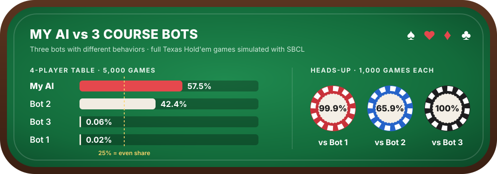

# Poker AI in Common Lisp

A Texas Hold'em player written in Common Lisp for an AI course. It plays full games against three bots
provided with the course, each with a different behavior.



## Results

Measured with SBCL on 8,000 full games (`benchmark.lisp`), with no engine errors.

| Setting | Games | AI win rate |
| --- | --- | --- |
| 4-player table (AI + 3 bots) | 5,000 | **57.5%** (an even share would be 25%) |
| Heads-up vs bot 1 | 1,000 | **99.9%** |
| Heads-up vs bot 2 | 1,000 | **65.9%** |
| Heads-up vs bot 3 | 1,000 | **100%** |

About 465,000 hands were played in total.

## How the AI works

The AI is in `players.lisp` (function `AI`).

1. **Starting hand score:** card ranks, a bonus for suited cards and a bonus for connected ranks.
2. **Board reading:** detects made hands (pair up to four of a kind, flush, straight) and penalises dangerous
   boards (paired board, three cards of one suit, straight draws).
3. **Blend:** the two scores are mixed. The board weighs more on later streets, with a random factor so the AI
   is harder to read.
4. **Decision:** a threshold-based policy. Fold a weak hand facing a big bet, call with a medium hand, raise a
   strong hand in proportion to its strength.

## Run it

Requires [SBCL](https://www.sbcl.org/).

```bash
sbcl --load main.lisp
```

Then, in the Lisp prompt:

```lisp
(test-1-round)   ; one hand with the AI and the three bots
(test-full-AI)   ; a full game until one player has all the chips
```

To reproduce the results:

```bash
sbcl --non-interactive --load benchmark.lisp
```

## Files

| File | Content |
| --- | --- |
| `players.lisp` | My AI, plus the three course bots (`noob1`, `noob2`, `noob3`) |
| `poker.lisp` | Game engine provided with the course, with three bug fixes |
| `main.lisp` | Entry points to play one round or a full game |
| `benchmark.lisp` | Plays thousands of games and prints the win rates |

## Credits and license

The game engine (`poker.lisp`, `main.lisp`) and the three bots were written by Paulo Garcia
(International School of Engineering, Chulalongkorn University) and are licensed under
[CC BY-NC-SA 4.0](https://creativecommons.org/licenses/by-nc-sa/4.0/).

I fixed three bugs in the engine, each marked `;fix:` in `poker.lisp`:

- the deck had no tens (the 11 was listed twice);
- split pots could give fractional chips, which the engine then rejected as a bet;
- a player left alone after everyone else folded was still asked to act, and chips bet only by folded
  players were never paid back.

This repository is shared under the same license, CC BY-NC-SA 4.0. See `LICENSE`.
